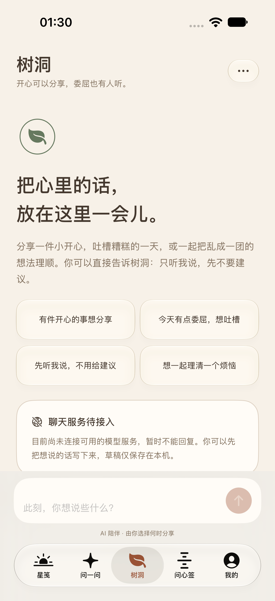
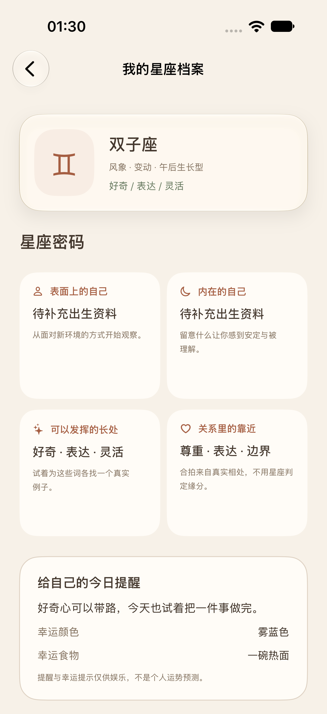
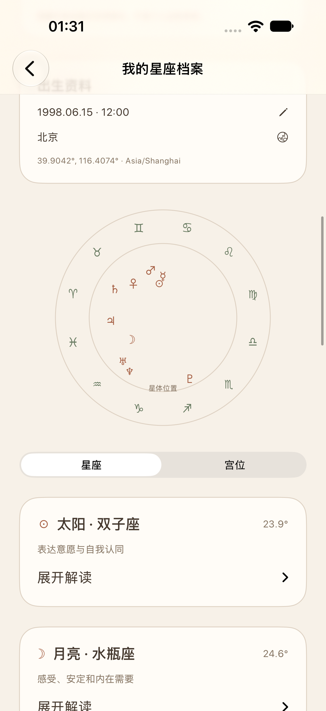

# 值得吗？

一份温柔的星笺，和重大决定前的 20 个自问。原生 SwiftUI，支持 iOS 17 及以上 iPhone / iPad。

## 运行

先运行依赖准备脚本（下载官方微信 SDK 并校验 SHA-256）：

```sh
bash scripts/bootstrap-wechat-sdk.sh
```

用 Xcode 打开 `值得吗？.xcodeproj`，选择 `值得吗？` scheme 和 iPhone 模拟器，按 `⌘R`。真机运行需在 Signing & Capabilities 选择自己的 Team，并使用唯一的 Bundle Identifier。公开仓库未绑定原开发者签名团队。第一次可直接建立无需联系方式的本机档案，填写昵称和出生信息即可使用。手机号必须完成真实短信验证；邮箱入口为明确标明未验证的本机建档；微信已接入官方 SDK，需配置真实应用与 HTTPS 后端才会显示授权入口。

## 本版内容

- 奶油白、陶土橙、鼠尾草绿；浅色 / 深色 / 跟随系统，设置立即生效并保存。
- iOS 26+ 原生 Liquid Glass 导航、切换器、档案卡片；更旧系统或降低透明度时使用实色回退。
- 出生年月日、可选时分、12 星座、元素与属性、节律标签、专属编号，可编辑。
- 日 / 周 / 月 / 年星笺，日期选择与前后切换，综合及七个生活方向的娱乐分数。
- 登录后首页为当天心情和五方向评分概览，点击进入日 / 周 / 月 / 年详情。
- 当日保留小小幸运的八个项目；周 / 月 / 年仅保留幸运色、数字和石头，并提供五方向详细文字。
- 每天三件不同的温柔小事，可勾选并按用户与日期保存；只在当日详情显示。
- 五条可展开的解读，轮换覆盖爱情、学业、事业、家庭、财运、人际、情绪，参考星座和最近一次真实答题，并标记来源。
- 独立设置页：账号安全、语言、显示设置、系统推荐分享、清除问答历史、关于、退出及底部数据隐私说明。
- 问心签代替底部决定簿：五种情绪、真实摇动 / 点按抽签、100 支原创签诗与独立的观音灵签 100 签、情绪适配解签和签笺历史。
- 完整 20 问、准备度、风险优先规则、草稿续答、位于「我的」的问答历史、复盘及文字分享。
- 28 种语言及跟随系统：核心导航、设置和 20 题完成翻译，支持从右到左布局；长篇内容和传统签诗的范围见 [语言适配说明](docs/Localization.md)。
- “我的”移除邮箱 / 状态行，问答首页移除指定的绿色图标文案。
- 不同档案的决定簿分开保存；首个档案接收原版本机记录，切换档案不会混合历史。
- 官方微信 OpenSDK 2.0.9 无支付版、授权回调、state 校验、后端交换调用、Keychain 登录态及 Python 服务端示例。

## 配置微信

见 `docs/WeChat-Setup.md` 和 `Configuration/WeChat.local.xcconfig.example`。需要审核通过的 AppID、Universal Link、域名配置和自己的 HTTPS 后端。**目前没有这些真实参数，微信真机授权尚未联调；不会用填写微信号或模拟验证码代替。** AppSecret 仅存在服务端环境，不进入 App。

## 配置短信与账号安全

见 [短信与账号接入](docs/SMS-Setup.md)。已接腾讯云官方发送 SDK、服务端验证码摘要 / 过期 / 次数 / 重放防护 / 限流、手机号 session、换绑、邮箱验证、密码设置、其他设备退出和注销。还没有短信凭证和部署域名，不能实际收短信；缺失配置会提示不可用，不返回假验证码或跳过验证。苹果、微博、QQ 保留入口，绑定暂未开放；好友分享使用系统面板，渠道取决于设备安装的分享扩展，没有伪造渠道。

## 数据与内容边界

出生信息、答题、任务、抽签与问答历史以 Codable JSON 保存在本机 UserDefaults。微信授权仅向配置的登录服务发送 code / state，应用 session 保存在 Keychain；手机号与验证码发往登录服务，服务端保留账号身份映射、验证码摘要及防滥用记录。无广告、无追踪 SDK。树洞在用户明确同意并主动发送后，将消息与最近最多 10 轮上下文交给配置的模型服务；未配置时不能生成回复。模型密钥只保存在服务端。卸载应用可能移除本机记录，系统备份由设备设置决定。

生日星座按常见区间匹配。补齐出生时间、地点与时区后，星座档案使用 Astronomy Engine 在本机计算主要星体、上升、天顶与整宫制宫位；资料缺失时不生成这些个人结果，婚神星暂未计算。占星文字仅为文化阅读。星笺分数与幸运项是按用户和周期生成的娱乐灵感；同一周期内容稳定，日常小事按本地日历轮换。不预测真实运势，不作心理诊断。

20 问每题记 0–3 分，总分 60 分换算为 0–100 准备度；高分不覆盖强烈情绪或不可承受风险。每个维度 4 题、12 分；旧版 15 题报告保留原计分，未完成旧草稿可继续补答到 20 题。准备度不是成功概率。五条解读没有答题时只用星座灵感，不编造答题信息。小事是可跳过的休息邀请，不是治疗方案。

## 验证

```sh
zsh scripts/check-model.sh
python3 scripts/check-localizations.py
python3 -m unittest discover -s backend -v
```

Xcode 按 `⌘U` 运行注册、周期切换、主题持久化以及完整 20 问 UI 测试，截图附于报告。Debug UI 测试使用独立 UserDefaults suite，不覆盖正常用户档案。真实微信授权必须在配置完成的真机验证。

发布前运行 `python3 scripts/check-release.py --app /path/to/值得吗？.app`。当前仍缺少真实主体、隐私政策与客服信息，未配置登录服务，也未提交审核。核对事项见 [审核准备](docs/Review-Readiness.md)，实际测试记录见 [验证记录](docs/Verification.md)。

### V6：树洞、抽签去重、星座档案

- 五栏原生玻璃导航的中间加入树洞；接入流程见 [树洞服务配置](docs/Tree-Hole-Setup.md)。默认未配置，无假回复；草稿可本机保存。
- 抽签有 204 条不同小事，按情绪筛选、按本机档案跨重启去重；内容耗尽时明确提示，不重复循环。
- 观音 15 个现代解读条目扩充。旧主题整句仅在整体解译出现。
- “我的”顶端星座卡可进入星座密码、今日提醒与星体 / 宫位阅读；补全准确出生时间、出生地和时区后在本机计算。宫位采用整宫制，暂不计算婚神星。

## 界面预览

以下为模拟器测试档案截图。

| 树洞 | 星座档案 | 本机星体计算 |
| --- | --- | --- |
|  |  |  |

## 第三方内容

- Astronomy Engine 使用 MIT License，完整授权随源码及 `值得吗？/Resources/Astronomy-LICENSE.txt` 保留。
- 摇签音效使用 CC0 实录，出处见 [内容来源](docs/Content-Provenance.md)。
- 微信 SDK 由准备脚本从腾讯官方地址下载，不在本仓库重新分发；使用时遵循腾讯相关条款。
- 本仓库没有为项目原创代码另行授予开源许可证。公开可见不等于已授权自由修改或再分发。
